# ERD Database CMS Politeknik Surabaya

Dokumen ini menggambarkan struktur database `politeknik_surabaya_cms` berdasarkan isi aktual:

- `database/02_create_tables.sql` — 27 tabel, primary key, dan unique key.
- `database/03_foreign_keys_indexes.sql` — 32 foreign key dan index tambahan.

Tidak ada SQL yang dijalankan dan tidak ada file lain yang diubah. Tipe data pada diagram disederhanakan (misalnya `varchar` tanpa panjang) agar sesuai sintaks Mermaid; panjang, enum, default, dan constraint lengkap tetap mengikuti file SQL.

## Legenda

| Notasi | Arti |
| --- | --- |
| `PK` | Primary key |
| `FK` | Foreign key |
| `UK` | Single-column unique key |
| Komentar `"UK: a, b"` | Kolom pertama dari composite unique key |
| `\|\|--o{` | Satu ke banyak; sisi kiri tepat satu, sisi kanan nol atau banyak |
| `\|o--o{` | Nol-atau-satu ke banyak |
| `\|o--o\|` | Nol-atau-satu ke nol-atau-satu (relasi one-to-one opsional) |
| `--` | Relasi identifikasi (foreign key) |
| `..` | Tidak dipakai; seluruh relasi di bawah adalah foreign key nyata |

## Diagram ERD

```mermaid
erDiagram
  admin_users {
    bigint id PK
    varchar username UK
    varchar email UK
    varchar password_hash
    varchar display_name
    enum role
    enum status
    datetime last_login_at
    timestamp created_at
    timestamp updated_at
  }
  site_settings {
    bigint id PK
    varchar setting_key UK
    longtext setting_value
    varchar setting_group
    enum input_type
    tinyint is_public
    smallint sort_order
    timestamp created_at
    timestamp updated_at
  }
  media {
    bigint id PK
    varchar file_name
    varchar original_name
    varchar file_path UK
    varchar mime_type
    varchar extension
    bigint file_size
    int width
    int height
    varchar title
    varchar alt_text
    text caption
    char checksum_sha256
    tinyint is_public
    bigint uploaded_by FK
    timestamp created_at
    timestamp updated_at
  }
  pages {
    bigint id PK
    varchar slug UK
    varchar title
    varchar file_name UK
    varchar nav_section
    varchar nav_path
    varchar meta_title
    varchar meta_description
    tinyint is_published
    smallint sort_order
    timestamp created_at
    timestamp updated_at
  }
  page_sections {
    bigint id PK
    bigint page_id FK "UK: page_id, section_key"
    varchar section_key
    enum section_type
    varchar heading
    varchar subheading
    longtext body
    json content_json
    bigint media_id FK
    smallint sort_order
    tinyint is_published
    timestamp created_at
    timestamp updated_at
  }
  institution_profile {
    bigint id PK
    varchar profile_key UK
    varchar legal_name
    varchar short_name
    varchar tagline
    longtext description
    text vision
    text address
    varchar phone
    varchar fax
    varchar whatsapp
    varchar email
    varchar website
    varchar npsn
    varchar sk_number
    smallint established_year
    bigint logo_media_id FK
    timestamp created_at
    timestamp updated_at
  }
  missions {
    bigint id PK
    bigint institution_profile_id FK
    text mission_text
    smallint sort_order
    tinyint is_active
    timestamp created_at
    timestamp updated_at
  }
  goals {
    bigint id PK
    bigint institution_profile_id FK
    text goal_text
    smallint sort_order
    tinyint is_active
    timestamp created_at
    timestamp updated_at
  }
  org_units {
    bigint id PK
    bigint parent_id FK
    varchar slug UK
    varchar name
    enum unit_type
    text description
    smallint sort_order
    tinyint is_active
    timestamp created_at
    timestamp updated_at
  }
  org_members {
    bigint id PK
    bigint org_unit_id FK
    varchar full_name
    varchar position_title
    bigint photo_media_id FK
    varchar email
    varchar phone
    smallint sort_order
    tinyint is_active
    timestamp created_at
    timestamp updated_at
  }
  programs {
    bigint id PK
    varchar code UK
    varchar slug UK
    varchar name
    varchar short_name
    bigint page_id FK, UK
    enum degree_level
    varchar accreditation
    tinyint duration_semesters
    text description
    tinyint is_featured
    enum status
    smallint sort_order
    timestamp created_at
    timestamp updated_at
  }
  program_tags {
    bigint id PK
    bigint program_id FK "UK: program_id, tag"
    varchar tag
    smallint sort_order
    timestamp created_at
    timestamp updated_at
  }
  program_items {
    bigint id PK
    bigint program_id FK
    enum item_type
    varchar title
    longtext body
    smallint sort_order
    tinyint is_published
    timestamp created_at
    timestamp updated_at
  }
  program_media {
    bigint id PK
    bigint program_id FK "UK: program_id, media_id, media_role"
    bigint media_id FK
    enum media_role
    bigint cover_program_id UK "generated column"
    varchar caption
    smallint sort_order
    timestamp created_at
    timestamp updated_at
  }
  post_categories {
    bigint id PK
    varchar slug UK
    varchar name
    text description
    smallint sort_order
    tinyint is_active
    timestamp created_at
    timestamp updated_at
  }
  channels {
    bigint id PK
    varchar slug UK
    varchar name
    text description
    bigint page_id FK, UK
    tinyint is_active
    smallint sort_order
    timestamp created_at
    timestamp updated_at
  }
  posts {
    bigint id PK
    bigint category_id FK
    bigint author_admin_id FK
    varchar title
    varchar slug UK
    text excerpt
    longtext body
    bigint cover_media_id FK
    enum status
    tinyint is_featured
    datetime published_at
    varchar meta_title
    varchar meta_description
    timestamp created_at
    timestamp updated_at
  }
  post_channels {
    bigint post_id PK, FK
    bigint channel_id PK, FK
    timestamp created_at
  }
  services {
    bigint id PK
    varchar slug UK
    varchar name
    text description
    varchar icon
    bigint page_id FK, UK
    enum status
    smallint sort_order
    timestamp created_at
    timestamp updated_at
  }
  service_items {
    bigint id PK
    bigint service_id FK "UK: service_id, title"
    varchar title
    text description
    varchar icon
    smallint sort_order
    tinyint is_active
    timestamp created_at
    timestamp updated_at
  }
  service_documents {
    bigint id PK
    bigint service_id FK "UK: service_id, media_id"
    bigint media_id FK
    varchar title
    enum document_type
    tinyint is_public
    smallint sort_order
    timestamp created_at
    timestamp updated_at
  }
  journals {
    bigint id PK
    bigint program_id FK
    varchar name
    varchar slug UK
    varchar abbreviation
    varchar issn UK
    varchar eissn UK
    varchar publisher
    varchar publication_frequency
    longtext description
    text editorial_board
    varchar website_url
    varchar contact_email
    bigint cover_media_id FK
    enum status
    timestamp created_at
    timestamp updated_at
  }
  journal_articles {
    bigint id PK
    bigint journal_id FK "UK: journal_id, slug"
    varchar title
    varchar slug
    text authors
    longtext abstract
    varchar keywords
    varchar volume
    varchar issue
    int page_start
    int page_end
    date published_at
    varchar doi UK
    bigint pdf_media_id FK
    enum status
    timestamp created_at
    timestamp updated_at
  }
  journal_documents {
    bigint id PK
    bigint journal_id FK "UK: journal_id, media_id"
    bigint media_id FK
    varchar title
    enum document_type
    tinyint is_public
    smallint sort_order
    timestamp created_at
    timestamp updated_at
  }
  tuition_periods {
    bigint id PK
    varchar academic_year "UK: academic_year, term"
    enum term
    varchar name
    enum status
    tinyint is_active
    timestamp created_at
    timestamp updated_at
  }
  tuition_components {
    bigint id PK
    bigint tuition_period_id FK "UK: tuition_period_id, component_code"
    varchar component_code
    varchar name
    text description
    decimal amount
    char currency
    varchar amount_label
    smallint sort_order
    tinyint is_active
    timestamp created_at
    timestamp updated_at
  }
  gallery_items {
    bigint id PK
    bigint media_id FK "UK: media_id, album_name"
    varchar title
    text description
    varchar album_name
    tinyint is_published
    smallint sort_order
    datetime published_at
    timestamp created_at
    timestamp updated_at
  }

  admin_users |o--o{ media : "uploaded_by (SET NULL)"
  admin_users |o--o{ posts : "author_admin_id (SET NULL)"
  pages ||--o{ page_sections : "page_id (CASCADE)"
  media |o--o{ page_sections : "media_id (SET NULL)"
  media |o--o{ institution_profile : "logo_media_id (SET NULL)"
  institution_profile ||--o{ missions : "institution_profile_id (CASCADE)"
  institution_profile ||--o{ goals : "institution_profile_id (CASCADE)"
  org_units |o--o{ org_units : "parent_id (SET NULL)"
  org_units ||--o{ org_members : "org_unit_id (RESTRICT)"
  media |o--o{ org_members : "photo_media_id (SET NULL)"
  programs ||--o{ program_tags : "program_id (CASCADE)"
  programs ||--o{ program_items : "program_id (CASCADE)"
  programs ||--o{ program_media : "program_id (CASCADE)"
  media ||--o{ program_media : "media_id (RESTRICT)"
  pages |o--o| programs : "page_id (SET NULL, unique)"
  pages |o--o| channels : "page_id (SET NULL, unique)"
  pages |o--o| services : "page_id (SET NULL, unique)"
  post_categories |o--o{ posts : "category_id (SET NULL)"
  media |o--o{ posts : "cover_media_id (SET NULL)"
  posts ||--o{ post_channels : "post_id (CASCADE)"
  channels ||--o{ post_channels : "channel_id (RESTRICT)"
  services ||--o{ service_items : "service_id (CASCADE)"
  services ||--o{ service_documents : "service_id (CASCADE)"
  media ||--o{ service_documents : "media_id (RESTRICT)"
  programs |o--o{ journals : "program_id (RESTRICT)"
  media |o--o{ journals : "cover_media_id (SET NULL)"
  journals ||--o{ journal_articles : "journal_id (CASCADE)"
  media |o--o{ journal_articles : "pdf_media_id (SET NULL)"
  journals ||--o{ journal_documents : "journal_id (CASCADE)"
  media ||--o{ journal_documents : "media_id (RESTRICT)"
  tuition_periods ||--o{ tuition_components : "tuition_period_id (CASCADE)"
  media ||--o{ gallery_items : "media_id (RESTRICT)"
```

## Relasi Kunci

### Many-to-many: `posts` dan `channels`

Relasi publikasi memakai pivot `post_channels`:

- `posts ||--o{ post_channels` — satu post dapat memiliki banyak baris pivot.
- `channels ||--o{ post_channels` — satu channel dapat memiliki banyak baris pivot.
- Primary key gabungan `(post_id, channel_id)` mencegah pasangan post–channel ganda.
- `post_channels.post_id` memakai `ON DELETE CASCADE`, sehingga baris pivot terhapus bersama post.
- `post_channels.channel_id` memakai `ON DELETE RESTRICT`, sehingga channel yang masih dipakai tidak dapat dihapus.
- `post_categories` tetap berdiri sendiri dan terhubung ke `posts.category_id` sebagai relasi satu-ke-banyak opsional.

### One-to-one opsional ke `pages`

Tiga tabel memiliki foreign key unik dan nullable ke `pages`:

- `programs.page_id` → `pages.id` (`ON DELETE SET NULL`)
- `channels.page_id` → `pages.id` (`ON DELETE SET NULL`)
- `services.page_id` → `pages.id` (`ON DELETE SET NULL`)

Karena kolomnya unik dan nullable, satu halaman paling banyak dipetakan ke satu program, satu channel, dan satu layanan; baris tanpa halaman tetap valid. Jika halaman dihapus, nilai foreign key menjadi `NULL`, bukan menghapus program, channel, atau layanan.

### Self-reference

`org_units.parent_id` menunjuk `org_units.id` dengan `ON DELETE SET NULL`, sehingga unit organisasi dapat memiliki induk dan anak dalam tabel yang sama tanpa terhapus saat induknya dihapus.

## Daftar Foreign Key

| # | Tabel anak | Kolom | Tabel induk | Kardinalitas anak → induk | ON DELETE |
|---:|---|---|---|---|---|
| 1 | `media` | `uploaded_by` | `admin_users.id` | 0..1 → 1 | SET NULL |
| 2 | `posts` | `author_admin_id` | `admin_users.id` | 0..1 → 1 | SET NULL |
| 3 | `page_sections` | `page_id` | `pages.id` | banyak → 1 | CASCADE |
| 4 | `page_sections` | `media_id` | `media.id` | 0..1 → 1 | SET NULL |
| 5 | `institution_profile` | `logo_media_id` | `media.id` | 0..1 → 1 | SET NULL |
| 6 | `missions` | `institution_profile_id` | `institution_profile.id` | banyak → 1 | CASCADE |
| 7 | `goals` | `institution_profile_id` | `institution_profile.id` | banyak → 1 | CASCADE |
| 8 | `org_units` | `parent_id` | `org_units.id` | 0..1 → 1 | SET NULL |
| 9 | `org_members` | `org_unit_id` | `org_units.id` | banyak → 1 | RESTRICT |
| 10 | `org_members` | `photo_media_id` | `media.id` | 0..1 → 1 | SET NULL |
| 11 | `program_tags` | `program_id` | `programs.id` | banyak → 1 | CASCADE |
| 12 | `program_items` | `program_id` | `programs.id` | banyak → 1 | CASCADE |
| 13 | `program_media` | `program_id` | `programs.id` | banyak → 1 | CASCADE |
| 14 | `program_media` | `media_id` | `media.id` | banyak → 1 | RESTRICT |
| 15 | `programs` | `page_id` | `pages.id` | 0..1 → 1 | SET NULL |
| 16 | `channels` | `page_id` | `pages.id` | 0..1 → 1 | SET NULL |
| 17 | `services` | `page_id` | `pages.id` | 0..1 → 1 | SET NULL |
| 18 | `posts` | `category_id` | `post_categories.id` | 0..1 → 1 | SET NULL |
| 19 | `posts` | `cover_media_id` | `media.id` | 0..1 → 1 | SET NULL |
| 20 | `post_channels` | `post_id` | `posts.id` | banyak → 1 | CASCADE |
| 21 | `post_channels` | `channel_id` | `channels.id` | banyak → 1 | RESTRICT |
| 22 | `service_items` | `service_id` | `services.id` | banyak → 1 | CASCADE |
| 23 | `service_documents` | `service_id` | `services.id` | banyak → 1 | CASCADE |
| 24 | `service_documents` | `media_id` | `media.id` | banyak → 1 | RESTRICT |
| 25 | `journals` | `program_id` | `programs.id` | 0..1 → 1 | RESTRICT |
| 26 | `journals` | `cover_media_id` | `media.id` | 0..1 → 1 | SET NULL |
| 27 | `journal_articles` | `journal_id` | `journals.id` | banyak → 1 | CASCADE |
| 28 | `journal_articles` | `pdf_media_id` | `media.id` | 0..1 → 1 | SET NULL |
| 29 | `journal_documents` | `journal_id` | `journals.id` | banyak → 1 | CASCADE |
| 30 | `journal_documents` | `media_id` | `media.id` | banyak → 1 | RESTRICT |
| 31 | `tuition_components` | `tuition_period_id` | `tuition_periods.id` | banyak → 1 | CASCADE |
| 32 | `gallery_items` | `media_id` | `media.id` | banyak → 1 | RESTRICT |

Total: **32 foreign key**.

## Daftar Unique Key

| # | Tabel | Kolom unique |
|---:|---|---|
| 1 | `admin_users` | `username` |
| 2 | `admin_users` | `email` |
| 3 | `site_settings` | `setting_key` |
| 4 | `media` | `file_path` |
| 5 | `pages` | `slug` |
| 6 | `pages` | `file_name` |
| 7 | `page_sections` | `page_id`, `section_key` |
| 8 | `institution_profile` | `profile_key` |
| 9 | `org_units` | `slug` |
| 10 | `programs` | `code` |
| 11 | `programs` | `slug` |
| 12 | `programs` | `page_id` |
| 13 | `program_tags` | `program_id`, `tag` |
| 14 | `program_media` | `cover_program_id` (generated) |
| 15 | `program_media` | `program_id`, `media_id`, `media_role` |
| 16 | `post_categories` | `slug` |
| 17 | `channels` | `slug` |
| 18 | `channels` | `page_id` |
| 19 | `posts` | `slug` |
| 20 | `services` | `slug` |
| 21 | `services` | `page_id` |
| 22 | `service_items` | `service_id`, `title` |
| 23 | `service_documents` | `service_id`, `media_id` |
| 24 | `journals` | `slug` |
| 25 | `journals` | `issn` |
| 26 | `journals` | `eissn` |
| 27 | `journal_articles` | `journal_id`, `slug` |
| 28 | `journal_articles` | `doi` |
| 29 | `journal_documents` | `journal_id`, `media_id` |
| 30 | `tuition_periods` | `academic_year`, `term` |
| 31 | `tuition_components` | `tuition_period_id`, `component_code` |
| 32 | `gallery_items` | `media_id`, `album_name` |

Total: **32 unique key**. Primary key setiap tabel juga merupakan index; total objek index di database adalah 27 primary key + 32 unique key + 32 index tambahan = **91 index**.

## Verifikasi

- Seluruh **27 tabel** pada `02_create_tables.sql` muncul sebagai entity di diagram.
- Seluruh **32 foreign key** pada `03_foreign_keys_indexes.sql` digambar sebagai relasi dan didaftarkan pada tabel foreign key.
- Seluruh **32 unique key** pada `02_create_tables.sql` tercantum, baik sebagai flag `UK` maupun komentar composite unique.
- Relasi `posts`–`channels` melalui `post_channels` digambar dari kedua sisi pivot dengan primary key gabungan.
- Relasi `programs.page_id` → `pages.id` digambar sebagai one-to-one opsional dan memakai flag `FK, UK`.
- Foreign key nullable digambar dengan sisi induk `|o`; foreign key wajib dengan sisi induk `||`.
- Tidak ada tabel, kolom relasi, atau constraint yang ditambahkan di luar file SQL.
